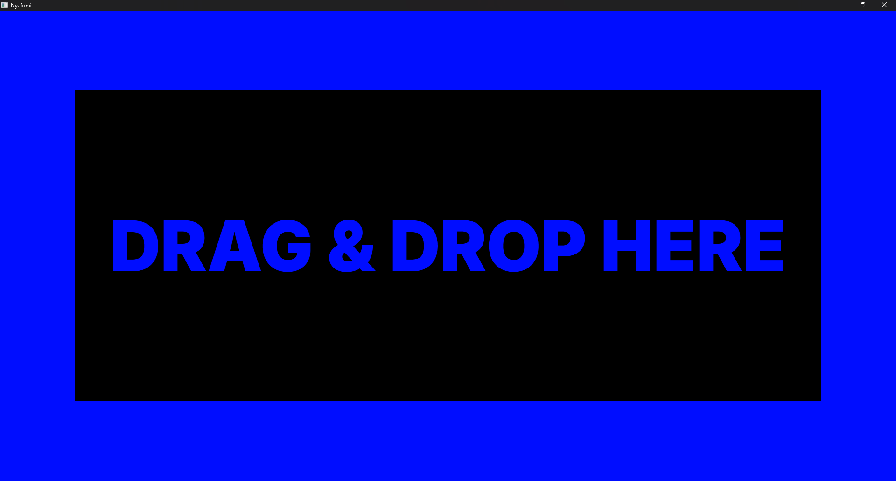
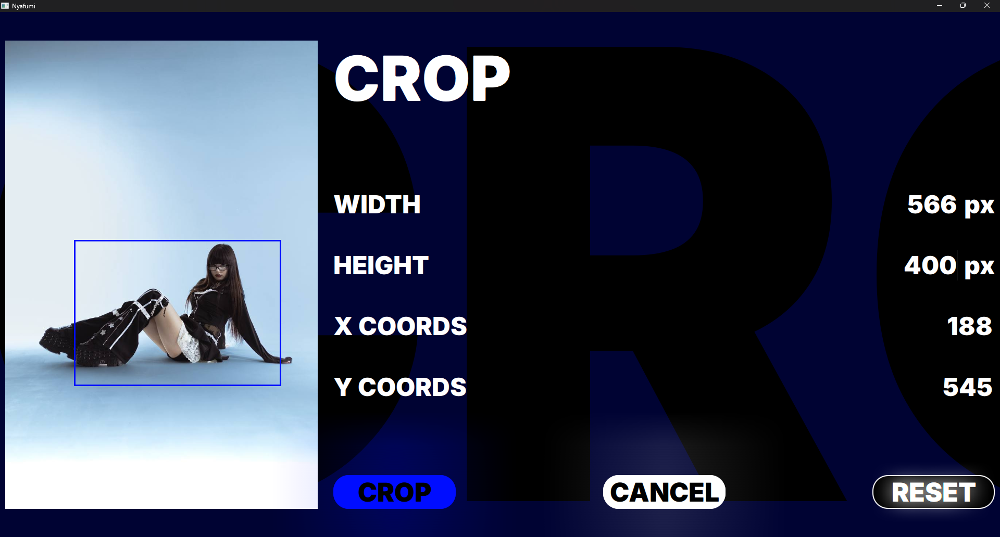
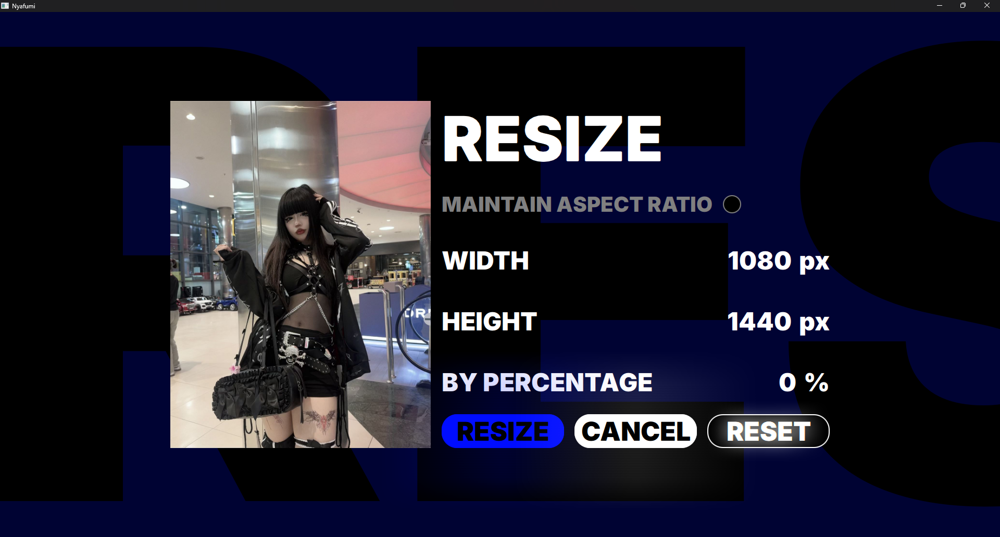
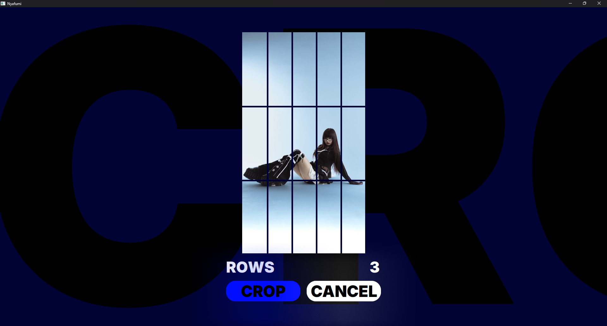
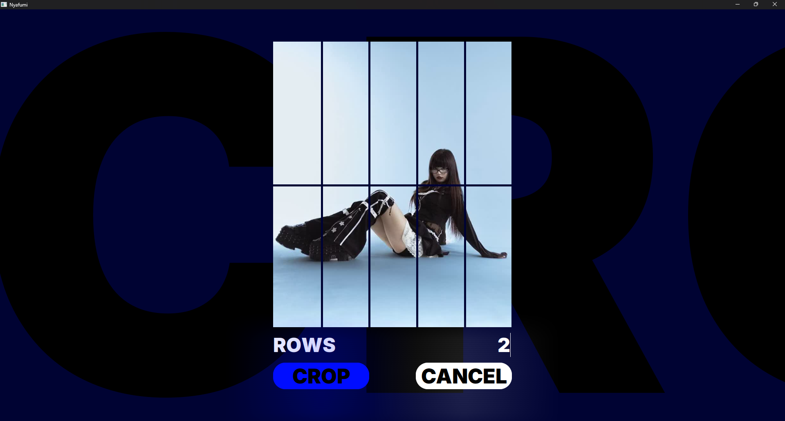

# nyafumi beta v1.0.1

nyafumi is a program that lets you resize and crop images and, most importantly, prepares images for upload to the **Steam Workshop Showcase**. All you have to do is select **"STEAM"** and click **CROP**.

The **README** will help you understand how to use **nyafumi**.

---

## Core Features

* Resize
* Crop
* Prepare for upload to the **Steam Workshop Showcase**

---

## Requirements

```bash
pip install -r requirements.txt
```

- [FFmpeg](https://ffmpeg.org/download.html) must be installed.
- After downloading, **add `ffmpeg/bin` to your system `PATH`.**
The application will automatically use ffmpeg from the system PATH if available.

---

## Project Structure

```
nyafumi/
├── venv/
│
├── ui/                  # Views (resize, crop, steam)
│
├── components/          # Custom UI components (button, crop area)
│
├── backend/             # UI classes
│
├── main.py              # App entry point
├── view_changer.py      # Changes the view
├── config.py            # Global state, settings, helpers
│
├── main.qml             # QML entry point
├── dragndrop.qml        # Choose the image
├── start.bat            # Use this to test if your VS code breakes the code
└── nyafumi.spec         # Pyinstaller parameters
```

---

## Global Architecture

**Object-oriented programming (OOP)** is used. Each QML file uses objects as needed. This ensures stability; if one part breaks, the entire program won't crash.

---

## main.py (Application Entry)

### Responsibilities

* Initialize QML
* Sets rootContexts

## Controllers

```text
/UIStateController.py     → resize controller
/CropController.py        → crop controller (uses for Crop page and Steam)
/ImageController.py       → Image Loading (used in all QML files that require image rendering)
```

---

## dragndrop.qml (Image choosing page)



### Responsibilities

Drag&Drop the image or left click

---

## crop.qml



### Responsibilities

* Set the size of the crop area
* Set the coordinates of the area

or
* Drag the area to change its coordinates

Crop saves the new image in the same folder as the original image (temporarily).

---

## resize.qml



### Responsibilities

* Maintain aspect ratio (checkbox)
* Change the resolution of the final image
* Change the resolution of the final image by a percentage
* Apply, Cancel (return to the Drag&Drop page), Reset (restore the original image data)

---

## SteamWorkshopShowcase.qml





### Features

Select the number of rows. **nyafumi will automatically replace the last byte with 67** so that Steam doesn't crop the image to a square in the showcase.
Creates 5, 10, or 15 images, depending on the value of `rows`, and saves them to the `steam` folder (which is created automatically).

---

## Build with PyInstaller

Example command:

```bash
pyinstaller nyafumi.spec
```

---

## Still Beta

The application is still in **beta stage**, so it may **experience crashes, glitches, or other unexpected behavior**.

---

## License

This project is licensed under the  
**Creative Commons Attribution–NonCommercial 4.0 International (CC BY-NC 4.0)**.

You are free to:
- View and download the source code
- Modify it for personal or non-commercial use

You are NOT allowed to:
- Use this project or any modified version of it for commercial purposes
- Sell or include it in paid products or services

See the LICENSE file for details.
